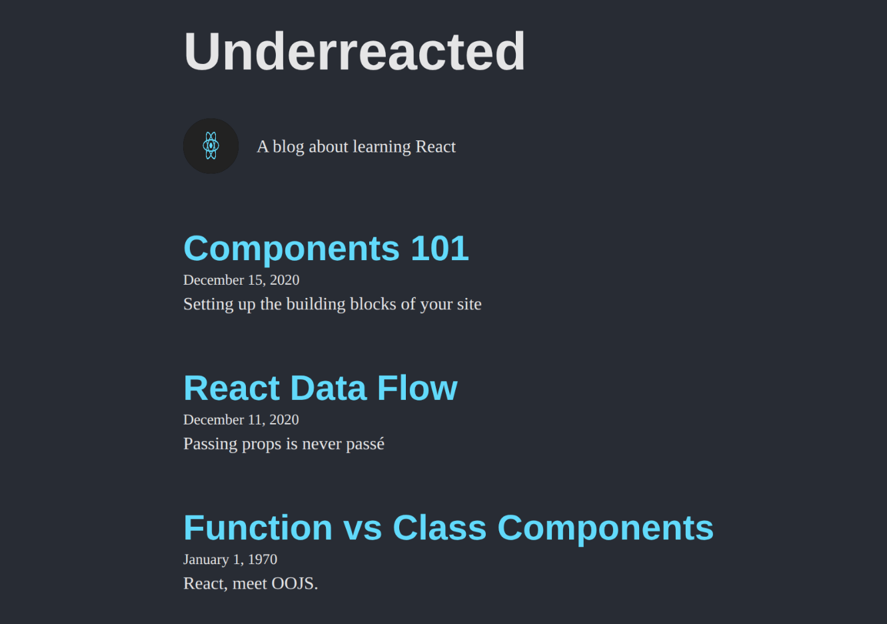

# Blog Site

A personal blog site built with React. It practises building components, writing JSX, and passing data down as props. The blog's information lives in one data file and is passed from `App` into the other components.

## Screenshot



## Component Tree

```
App
├── Header
├── About
└── ArticleList
    └── Article
```

| Component | What it shows | Props |
|---|---|---|
| `Header` | The blog's name in an `<h1>` | `name` |
| `About` | The blog logo and a short description | `image`, `about` |
| `ArticleList` | A list of articles, one `Article` per post | `posts` |
| `Article` | A post's title, date, and preview | `title`, `date`, `preview` |

`Article` shows a default date if none is passed, and `About` uses a default image if none is passed.

## Getting Started

1. Clone the repository:
   ```
   git clone <your-repo-url>
   cd <folder-name>
   ```
2. Install dependencies:
   ```
   npm install
   ```
3. Start the development server:
   ```
   npm run dev
   ```
4. Open the link shown in the terminal (usually http://localhost:5173).

## Running Tests

```
npm run test
```

## Changing the Blog Content

All blog content is in `src/data/blog.js`. Edit the `name`, `about`, or `posts` there and the page updates.

## Author

Peter Mboya